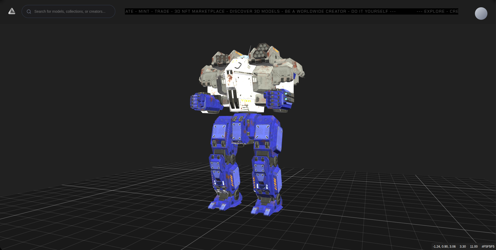

<div align="center">

# 4V4 — 3D Mod MKT on BTC L2 Stacks

**Explore, upload, and sell 3D assets.**

[](https://www.stacks.co/)
[](https://nextjs.org/)
[](https://docs.stacks.co/clarity)
[](#project-status)



</div>

4V4 is a marketplace for discovering and selling 3D assets, built on Bitcoin L2 Stacks. Model files and JSON metadata live on IPFS. A single shared Clarity contract stores only each asset's model CID, metadata CID, seller, price, and listing state, avoiding a new NFT contract and on-chain metadata for every upload.

> [!WARNING]
> **Development project:** the smart contracts have not been audited and are not intended for production use.

## Contents

- [Features](#features)
- [Project status](#project-status)
- [Tech stack](#tech-stack)
- [Getting started](#getting-started)
- [License](#license)

## Features

- Explore 3D assets from one shared marketplace registry
- Upload model files and metadata to IPFS
- List assets and accept STX payments through the shared `model-market` contract
- Change prices and delist assets
- Connect Hiro wallets for Devnet testing

## Project status

4V4 is under development and intended for local development and testing. Features and contract behavior may change.

### Asset storage model

- **IPFS:** model binary, preview image, and complete JSON metadata.
- **Stacks:** model CID, metadata CID, seller, asking price, and active status.
- **Marketplace:** one deployment named `model-market`; uploads do not deploy their own contracts.

The contract currently represents a sale as a one-time transfer: after a successful purchase, the buyer becomes the recorded seller and the listing closes. A buyer can create a new listing for the asset by submitting its CIDs again. CIDs are references; the contract does not guarantee that content remains pinned.

## Tech stack

| Area | Tools |
| --- | --- |
| Frontend | Next.js, React, TypeScript |
| Smart contracts | Clarity, Clarinet |
| Blockchain | Stacks |
| Wallet and developer tooling | Hiro Platform |

## Getting started

### Prerequisites

- Node.js 20.9 or newer
- npm 10 or newer
- A [Hiro Platform](https://platform.hiro.so) account with a Devnet project
- Recommended: [Clarinet](https://github.com/hirosystems/clarinet) and the [Clarity VS Code extension](https://marketplace.visualstudio.com/items?itemName=HiroSystems.clarity-lsp)

### 1. Start a Hiro Devnet

1. Sign in to [Hiro Platform](https://platform.hiro.so).
2. Start Devnet in your project.
3. Copy the API key from the Devnet API or project settings.

### 2. Install dependencies

From the repository root, install dependencies for both the contracts and frontend:

```bash
git clone https://github.com/fabohax/4v4.git
cd 4v4

cd clarity
npm ci

cd ../front-end
npm ci
cp .env.example .env
```

Add your Hiro Platform API key to `front-end/.env`:

```dotenv
NEXT_PUBLIC_PLATFORM_HIRO_API_KEY=your-api-key-here
```

### 3. Run the frontend

From the `front-end` directory:

```bash
npm run dev
```

Open [http://localhost:3000](http://localhost:3000) in your browser.

### Validate changes

From the repository root, run the contract checks and frontend checks with the matching project dependencies:

```bash
cd clarity
npm ci
npm run test
clarinet check

cd ../front-end
npm ci
npm run lint
npm run build
```

The contract tests run against Clarinet Simnet and target the `model-market` contract. Keep `NEXT_PUBLIC_STACKS_NETWORK=devnet` for local development; configure testnet explicitly for a testnet deployment.

### Prepare a testnet deployment

Create `clarity/settings/Testnet.toml` locally with a dedicated testnet deployer account. This file is gitignored and must not be committed. From `clarity/`, generate a plan for the contracts in `Clarinet.toml`:

```bash
clarinet deployments generate --testnet --manual-cost
```

Review the generated plan and contract address before applying it. Do not use a mainnet account or plan for development and testnet work.

## License

See the repository [LICENSE](./LICENSE) file.

---

<div align="center">Open source, built with ♥️</div>
